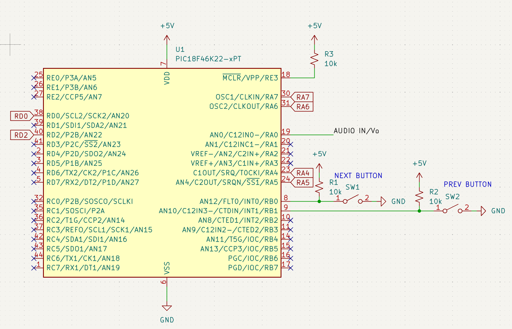
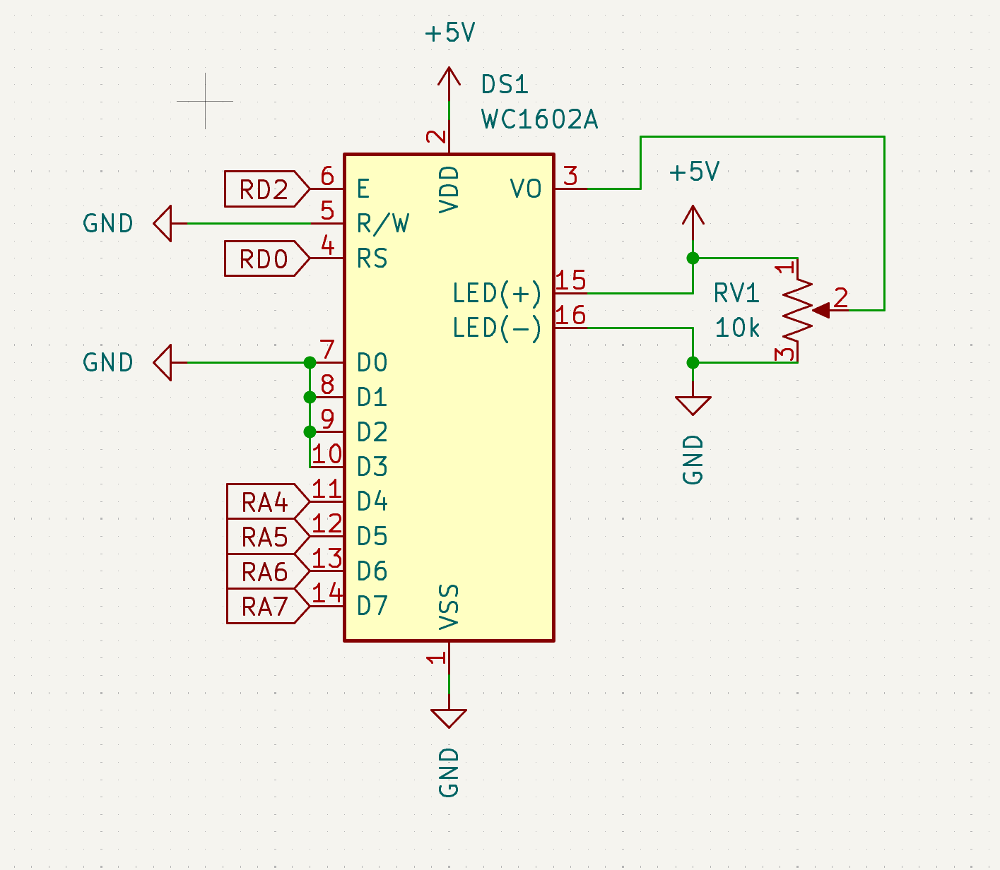
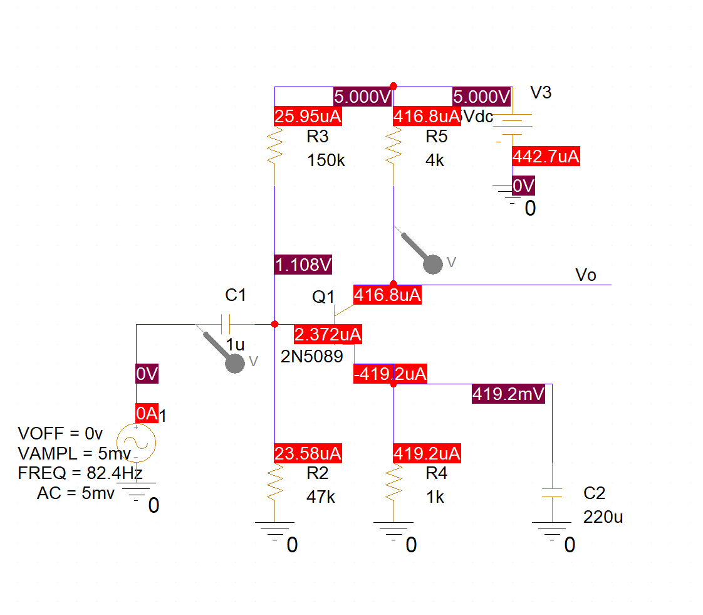

# guitar-tuner
Repository used to store the files for our ECE 3301 Project

## File Tree
<!-- FILETREE:START -->
```text
/
├── .gitignore
├── Guitar Tuner.X/
│   ├── Makefile
│   ├── inc/
│   │   ├── Configuration.h
│   │   ├── LCD.h
│   │   ├── adc_dsp.h
│   │   ├── display.h
│   │   ├── string_select.h
│   │   └── tuner_control.h
│   ├── nbproject/
│   │   ├── configurations.xml
│   │   └── project.xml
│   └── src/
│       ├── LCD.c
│       ├── adc_dsp.c
│       ├── display.c
│       ├── main.c
│       ├── string_select.c
│       └── tuner_control.c
└── Schematics/
    ├── Audio Amplifier updated.png
    ├── LCD_Schematic.png
    └── PIC18F46K22_Schematic.png
```
<!-- FILETREE:END -->

## Schematics



